<div align="center">

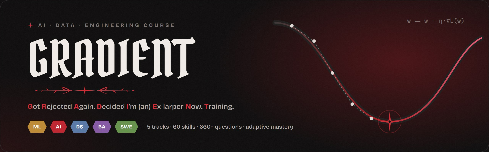

<br>


-a8191f?style=for-the-badge&logo=python&logoColor=white&labelColor=0c0b0b)


[**▶ Play it live**](https://frankponce.me/gradient-course/) · [**Overview**](#-overview) · [**Features**](#-features) · [**LeetCode hub**](#-the-leetcode-hub) · [**Game layer**](#-the-game-layer) · [**Tracks**](#-the-ten-tracks) · [**Mastery engine**](#-how-mastery-works) · [**Design**](#-design) · [**Architecture**](#%EF%B8%8F-architecture) · [**Quickstart**](#-quickstart) · [**Adding content**](#%EF%B8%8F-adding-content) · [**Repo map**](#%EF%B8%8F-repository-map)

</div>

---

## 🎯 Overview

GRADIENT is a **self-contained, adaptive course** for interview prep and upskilling across coding interviews (LeetCode and HackerRank), machine learning, generative AI, agentic AI, ML system design, statistics, analytics, software engineering and investing, with a gentle Foundations track to start from. It's also a game: XP, levels with increasingly unhinged career titles, coins, streaks, daily quests, a shop with cursed pets, and a fake stock exchange for your coins. Every answer updates a per-skill ability estimate, and the course steers you to whatever needs work next: lesson, practice set, targeted drill or full mock test.

> *Got Rejected Again. Decided I'm (an) Ex-larper Now. Training.* The name is the plan.

| | |
|---|---|
| **Problem** | Interview prep for data and AI roles is scattered across a dozen sites, none of which know what you're actually weak at. |
| **Goal** | One place that teaches each skill, tests it with real interview-style questions, measures mastery per skill, and keeps pointing you at the gap. |
| **The twist** | No build step, no backend, no dependencies. Open `index.html` over any static server and the whole course (question generators, timed mocks, 17 interactive diagrams, a Python runtime) runs in your browser. |
| **Built by** | [Frank Mediavilla](https://github.com/FrankPonce) |
| **Stack** | HTML · CSS (custom properties, one stylesheet for both themes) · vanilla JavaScript · SVG diagrams · Web Workers (JS runner) · Pyodide (Python runner) · localStorage |

| Dashboard | Agentic AI track |
|---|---|
| 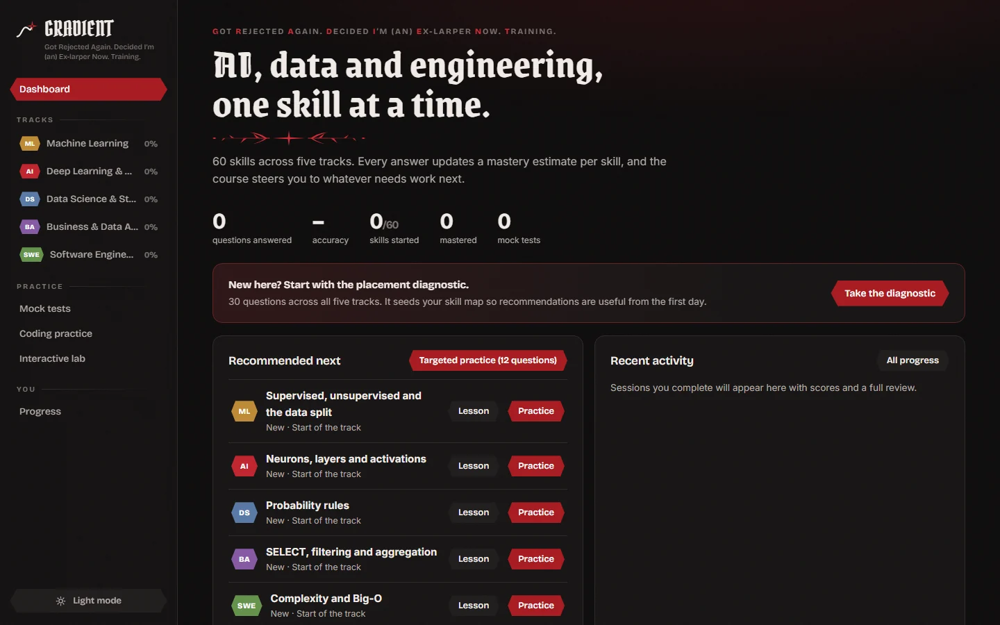 | 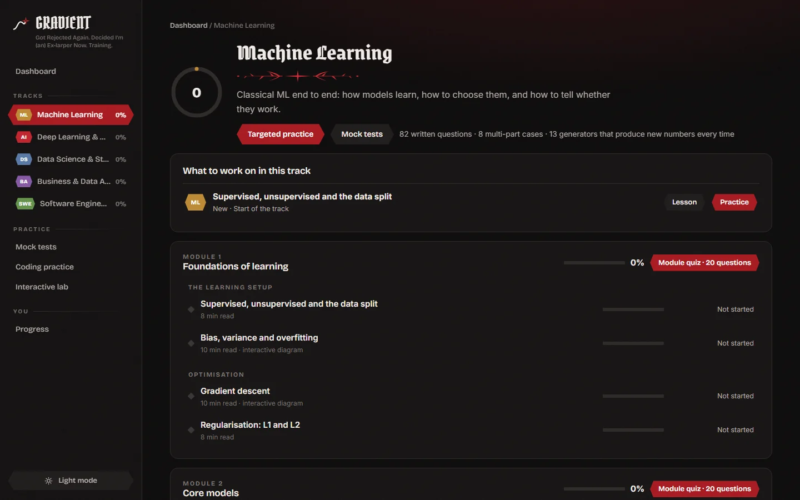 |
| **Lesson + live diagram** | **Interactive lab** |
| 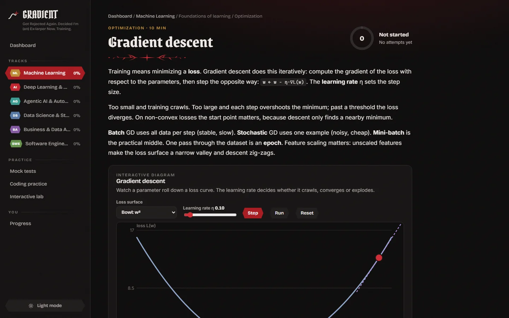 | 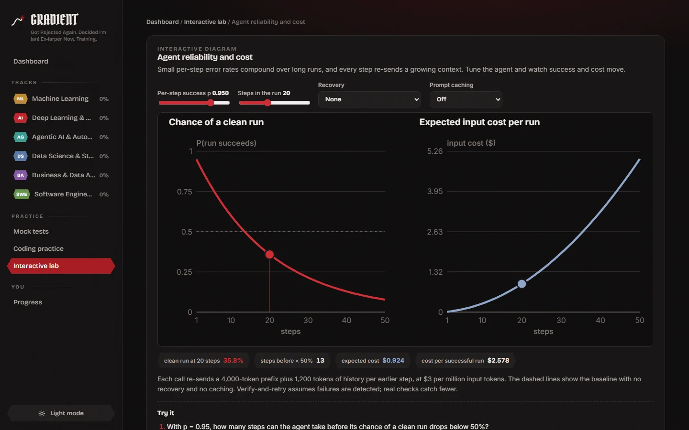 |
| **Mock tests** | **Coding practice** |
| 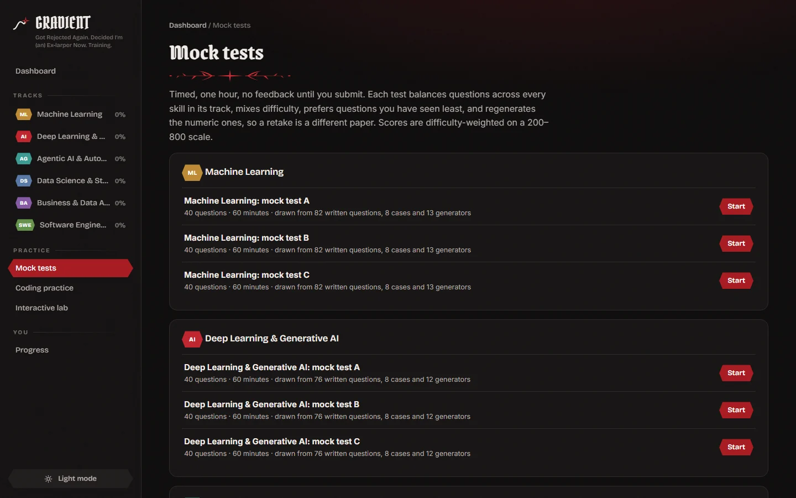 | 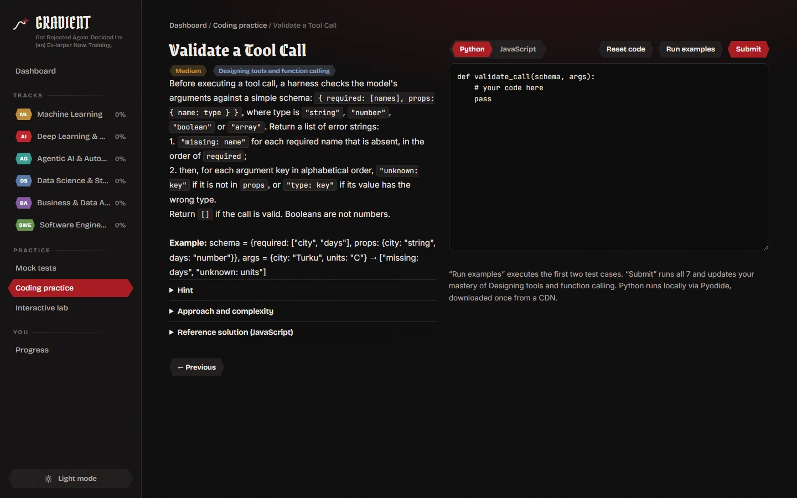 |
| **Practice with feedback** | **Light mode** |
| 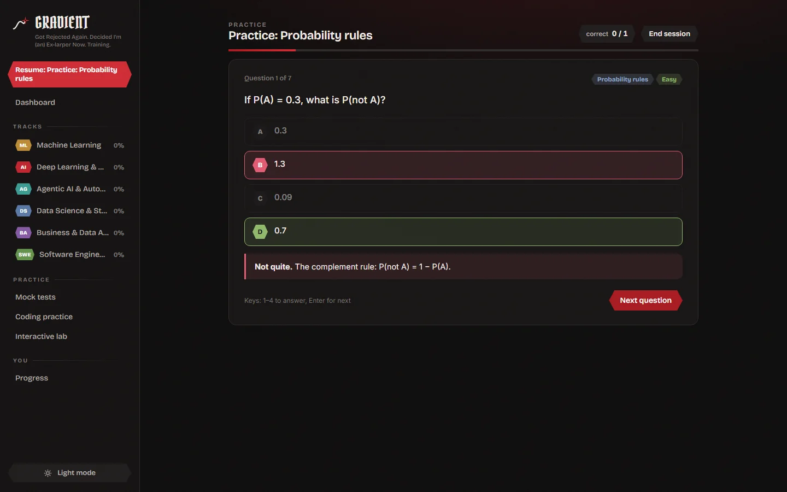 | 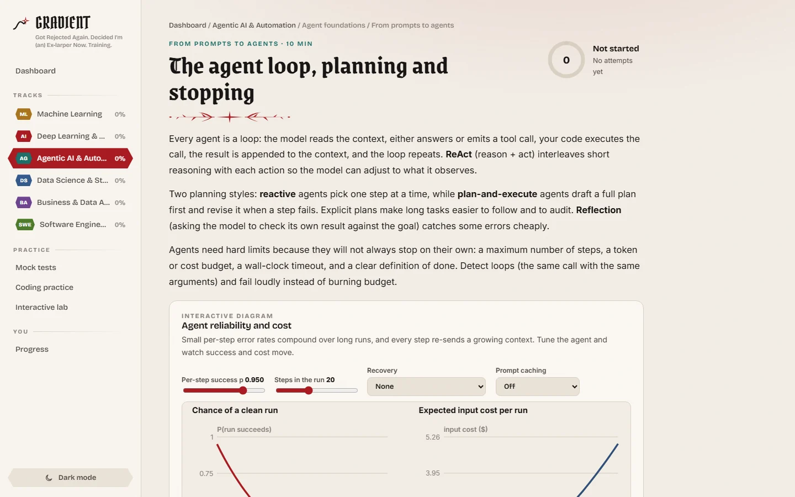 |

---

## ✨ Features

| Area | What it does |
|---|---|
| 📚 **Curriculum** | 10 tracks → 41 modules → topics → **141 lessons**, each teaching exactly one skill, with key takeaways and links to related skills |
| ❓ **Question bank** | **~850 hand-written questions** with explanations, plus **132 parametric generators** that produce new numbers on every draw, so you can't memorize the answer key |
| 🧩 **Cases** | **73 multi-part cases** (372 linked questions) built around a shared table, code listing, chart, trace or diagram · 27 regenerate their data on every draw · each part can credit a different skill |
| 🎯 **Practice modes** | Per-skill practice · 20-question module quizzes · targeted drills on your weakest skills · a 30-question placement diagnostic that seeds your skill map on day one |
| ⏱️ **Mock tests** | 3 one-hour tests per track + 4 cross-track mixes (including an AI-engineer mix) · 34 tests in all · timed, no feedback until submit · scored on a difficulty-weighted **200–800** scale · full review with explanations |
| 📈 **Analytics** | Mastery per skill, module and track · score history · strengths and weaknesses · improving and slipping skills · a full skill map |
| 🔬 **Interactive lab** | **37 hands-on diagrams**, including **18 step-through algorithm visualizers** (below), compounding and fees, agent reliability and cost, gradient descent, polynomial fit, regression, ROC thresholds, k-means, neural nets, self-attention, temperature, CLT, Bayes, A/B power, SQL joins, funnels, sorting, binary search, BFS/DFS, Big-O |
| 💻 **Coding** | **65 problems** runnable in the browser: 55 in **Python or JavaScript** against test cases (two of them HackerRank-style raw input/output), plus **10 SQL problems** run in real SQLite against two datasets each · hints, approach and solutions · submissions feed the same skill mastery as quizzes |
| 🌒 **Themes** | Gothic dark mode by default, a parchment light mode one click away · choice is remembered · every chart and diagram follows the theme |
| 💾 **Your data** | Progress lives in your browser's localStorage · export and import it as JSON from the Progress page · one-click reset |

---

## 🧩 The LeetCode hub

The most elaborate part of the course: a full coding-interview program at `#/lc`.

| | |
|---|---|
| 🗺️ **Pattern map** | ~18 patterns that cover most interview problems (hashing, two pointers, sliding window, prefix sums, binary search on the answer, monotonic stacks, linked lists, heaps, intervals, tree recursion, BSTs, tries, BFS/DFS, topological sort, union-find, Dijkstra, backtracking, 1-D and 2-D DP, greedy, bit tricks). Each has a lesson with "reach for it when you see…" signals and a reusable Python template |
| ▶️ **18 algorithm visualizers** | Step-through players with play, pause, step back and forward (or ← →), a speed control and your own input. The executing line of code is highlighted, and the pointers, stacks, queues, heaps, hash maps, DP tables, recursion trees and graphs update at every step |
| 🧠 **Pattern-recognition drill** | Problems described in plain words; you name the pattern. Trains the skill interviews actually test |
| ✅ **Classic problem tracker** | 152 well-known LeetCode problems grouped by pattern and difficulty, linked to LeetCode, with filters. Ticking one pays XP and coins |
| 💻 **Solve them here** | 30 interview problems that run in the browser in Python or JavaScript, including HackerRank-style problems that parse raw input |
| ⏱️ **Mock interview** | A random medium problem with a 45-minute timer, phase prompts ("clarify", "code while narrating", "test"), and hints hidden until you finish |
| 🎤 **The interview itself** | Lessons on online assessments (HackerRank, CodeSignal), the live coding round, behavioral stories (STAR), an 8-week study plan, and offers and negotiation |

---

## 🎮 The game layer

Good content is still boring if nothing happens when you get it right. So things happen.

| | |
|---|---|
| ⭐ **XP and levels** | Every answer earns XP (harder questions more, wrong answers a pity 2). Combos multiply it. Lessons, solved problems and finished sessions pay out too |
| 🪦 **Career titles** | Each level unlocks a title, from *"Your resume is a cry for help"* and *"Google won't even look at your resume"* (level 2) through *"You might actually pass the 1st interview. Good luck on the 2nd round tho."* (level 10) to *"You ARE the interview loop"* (level 30) |
| 🔥 **Combos and streaks** | Consecutive correct answers build a combo (up to +100% XP). Practicing on consecutive days builds a streak that pays coins daily |
| 📜 **Daily quests** | Three random quests a day ("hit an 8-answer combo", "practice in 2 tracks", "solve a SQL problem"), +25 coins each and +60 for clearing all three |
| 🏆 **Achievements** | 26 of them, from *First blood* to *Night owl* and *Character development* (get 50 answers wrong; it's called learning) |
| 🪙 **Coins and the shop** | Spend coins on animated companions that live in the corner and heckle you (Void the cat, Nyx the bat, Boo-lean the ghost, Overfit the raven, Null the skull), power-ups (50/50, double XP, streak freeze), accent colors and a cursor ember trail |
| 📈 **Coin exchange** | Invest your coins in five made-up assets (from the Gradient Index Fund to MeowCoin) with prices that tick hourly, a 1% fee and real P/L. It's the practice ground for the Investing track |
| ✨ **Juice** | Floating XP, confetti, a full-screen level-up, toasts, pets that hop when you're right and sulk when you're wrong, drifting embers, optional sound effects. All motion respects `prefers-reduced-motion` |

Everything lives in your browser's localStorage, alongside your progress, and comes along in the progress export.

---

## 🧭 The ten tracks

| | Track | What it covers |
|:---:|---|---|
|  | **Coding Interviews** | LeetCode and HackerRank prep: problem-solving process, complexity budgets, the pattern map, hashing through dynamic programming with templates and visualizers, plus online assessments, live coding rounds, behavioral interviews, study planning and negotiation |
|  | **Foundations** | The on-ramp: functions, exponents and logs, derivatives and gradients, vectors and matrices, averages and probability, Python essentials, NumPy, pandas, kinds of data, the life of a data project, how interviews work |
|  | **Machine Learning** | The learning setup, bias/variance, gradient descent, regularization, linear and logistic regression, trees and ensembles, k-NN and SVMs, metrics, ROC/AUC, cross-validation and leakage, k-means, PCA |
|  | **Deep Learning & Generative AI** | Neurons and backprop, training deep nets, CNNs, RNNs/LSTMs, attention and transformers, tokens and embeddings, pretraining and sampling, prompting and RAG, tool use and agents, evals, serving and monitoring |
|  | **Agentic AI & Automation** | Workflow vs agent patterns, the agent loop and stopping rules, tool design, MCP, context engineering, memory, agentic retrieval, multi-agent systems, workflow automation (triggers, retries, idempotency), coding and computer-use agents, agent evals (pass@k vs pass^k), prompt-injection defense, cost and reliability in production |
|  | **Data Science & Statistics** | Probability, Bayes, distributions, the CLT, confidence intervals, hypothesis tests, descriptive stats, cleaning and feature engineering, correlation vs causation, regression, time series |
|  | **Business & Data Analytics** | SQL, joins, window functions and CTEs, KPIs and funnels, cohorts and retention, unit economics, A/B test design and pitfalls, charts and dashboards, product sense, data modeling |
|  | **ML System Design** | Framing and metrics, labels and feedback loops, feature stores, batch and streaming pipelines, lakes and Parquet, retrieval and ranking, training pipelines, serving and p99 latency, drift monitoring, shadow/canary/A-B rollout, and full designs for a recommendation feed, fraud detection and search |
|  | **Investing & Trading** | Compounding, asset classes, risk and drawdowns, order books and spreads, valuation, bonds and duration, diversification, beta/alpha/Sharpe, fees and index funds, trading strategies, backtesting traps, options, position sizing and behavioral biases. Education, not financial advice |
|  | **Software Engineering** | Big-O, arrays and hashing, binary search, sorting, linked lists/stacks/queues, trees and heaps, graphs, recursion and backtracking, DP, system design, databases, testing and APIs |

---

## 🧠 How mastery works

The engine lives in [`js/core.js`](js/core.js). Each skill has an ability estimate **θ**, and every question has a difficulty **b**.

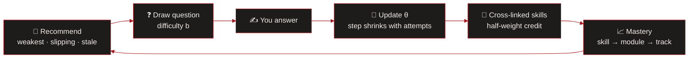

- **Expected score:** P(correct) = `0.25 + 0.75 · sigmoid(θ − b)`, where 0.25 is the guessing floor on four options.
- **Update:** after every answer θ moves toward the evidence with a step that shrinks as attempts accumulate, so a hard question answered right moves mastery more than an easy one.
- **Cross-skill credit:** questions can be linked to secondary skills, which get half-weight credit.
- **Recommendations:** skills are ranked by low mastery, recent decline and staleness, then by the next unstarted lesson in sequence.

---

## 🌒 Design

Gothic, but still a study tool. The look borrows from the rest of my work: the blood-and-bone palette of [Stray Club](https://stray-club.shop) and the crimson, blackletter and sigil shapes of [frankponce.dev](https://frankponce.dev).

| | |
|---|---|
| **Palette** | Near-black canvas `#0C0B0B` · soot surfaces · bone text · blood `#A8191F` as the single accent. Light mode swaps to parchment and ink with the same red |
| **Type** | **Pirata One** for the wordmark · **Grenze Gotisch** for page titles · **Bricolage Grotesque** for UI · **Inter** for reading · **JetBrains Mono** for code |
| **Shapes** | Hex-clipped buttons, nav items, tags and track chips · a thorn-and-star sigil under every page title · diamond markers for mastery levels |
| **Texture** | A faint film grain and a blood-red glow at the top of the page, kept subtle so long lessons stay readable |
| **Theming** | Every color is a CSS custom property, including the ones inside SVG charts and diagrams, so the toggle in the sidebar restyles everything instantly. Dark is the default; the choice is saved in localStorage |

---

## 🏗️ Architecture

Plain `<script>` tags loaded in order, all hanging off one global `GR` namespace. Content is data, views are template strings, and routing is the URL hash.

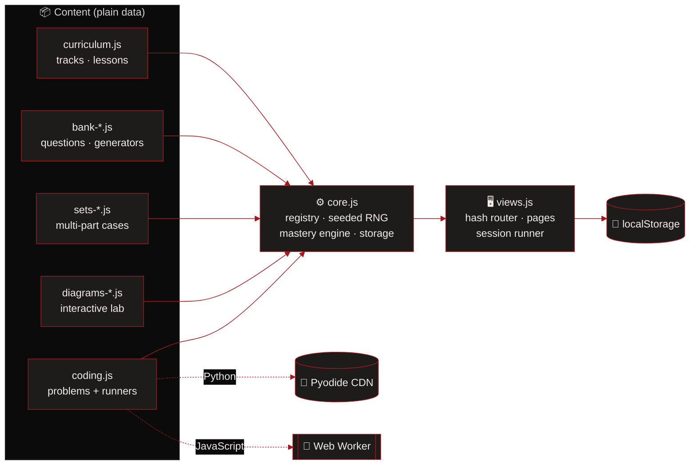

---

## 🚀 Quickstart

**Play it live: [frankponce.me/gradient-course](https://frankponce.me/gradient-course/)** (deployed from `main` with GitHub Pages; every push redeploys).

Or run it locally.
Any static file server works. With Python:

```bash
python -m http.server 5173
```

Then open **http://localhost:5173**.

<sub>The Python code runner downloads Pyodide from a CDN the first time you use it; everything else works offline. Opening <code>index.html</code> straight from disk (<code>file://</code>) won't work for the code runners, so use a server.</sub>

---

## ✍️ Adding content

Everything is plain data. Add an entry and it shows up everywhere it belongs (practice, quizzes, mocks, analytics).

<details>
<summary><b>❓ Question</b> · <code>js/bank-*.js</code></summary>

```js
Q("skill.id", 2, "Stem text", ["correct", "wrong", "wrong", "wrong"], "Explanation", ["optional.cross.skill"])
```
The first option is the correct one; options are shuffled at runtime. Difficulty is 1–3.
</details>

<details>
<summary><b>🎲 Generator</b> · <code>js/bank-*.js</code></summary>

```js
G("skill.id", 2, (r) => ({ stem, opts: [correct, ...wrong], expl }))
```
`r` is a seeded RNG with `r.int`, `r.pick` and `r.shuffle`, so every draw gets new numbers.
</details>

<details>
<summary><b>🧩 Case</b> · <code>js/sets-*.js</code></summary>

```js
S("skill.id", "Title", { stim: html, parts: [[skill, difficulty, stem, [correct, ...wrong], explanation, [crossSkills]], ...] })
```
Pass `(r) => ({ stim, parts })` instead to regenerate the data each time. Build the stimulus with `GR.tbl(headers, rows, caption)`, `GR.code(text)`, `GR.viz.line`, `GR.viz.bars` and `GR.viz.graph`. Parts stay together and in order, and each can credit a different skill.
</details>

<details>
<summary><b>📚 Lesson</b> · <code>js/curriculum.js</code></summary>

Add an `L(skill, title, minutes, bodyHtml, keyTakeaways, { diagram, related })` entry under a topic. It registers a new skill automatically.
</details>

<details>
<summary><b>🔬 Diagram</b> · <code>js/diagrams-*.js</code></summary>

```js
GR.diagrams.id = { title, blurb, skills, tasks, mount(host) }
```
Then reference it from a lesson with `diagram: "id"`.
</details>

<details>
<summary><b>💻 Coding problem</b> · <code>js/coding.js</code></summary>

```js
P(id, title, difficulty, skill, { desc, js, py, tests, hint, approach, sol })
```
</details>

---

## 🗂️ Repository map

```
.
├── index.html            # shell: nav + main, loads every script in order
├── css/
│   └── app.css           # the whole design system: gothic dark + light themes
├── js/
│   ├── core.js           # GR registry, seeded RNG, storage, mastery engine, question drawing
│   ├── curriculum.js     # tracks → modules → topics → lessons
│   ├── bank-ml.js        # questions + generators, one file per track
│   ├── bank-ai.js
│   ├── bank-ag.js        # agentic AI & automation
│   ├── track-fnd.js      # Foundations: lessons, questions and cases in one file
│   ├── track-sd.js       # ML System Design
│   ├── track-fin.js      # Investing & Trading
│   ├── track-lc.js       # Coding Interviews: lessons + the 152-problem classic list
│   ├── bank-lc.js        # its questions, pattern-recognition drill and cases
│   ├── extras.js         # gap-filler lessons (boosting, imbalance, fine-tuning, causal inference, estimation), compounding diagram, more problems
│   ├── bank-ds.js
│   ├── bank-ba.js
│   ├── bank-swe.js
│   ├── sets-a.js         # multi-part cases
│   ├── sets-b.js
│   ├── sets-c.js
│   ├── sets-d.js         # agentic cases: traces, tool schemas, injection, evals, costs
│   ├── diagrams-a.js     # lab toolkit + ML/AI diagrams
│   ├── diagrams-b.js     # stats, analytics and algorithm diagrams
│   ├── diagrams-c.js     # agent reliability and cost
│   ├── diagrams-lc.js    # step-through player + 18 algorithm visualizers
│   ├── coding.js         # coding + SQL problems; JS (Worker), Python (Pyodide) and SQL (sql.js) runners
│   ├── coding-lc.js      # 30 interview problems, including HackerRank-style I/O
│   ├── game.js           # XP, levels, coins, quests, achievements, shop, pets, coin exchange, effects
│   ├── lc-hub.js         # LeetCode hub: pattern map, tracker, cheat sheets, study plan, mock interview
│   └── views.js          # router, dashboard, track, lesson, sessions, results, tests, progress, lab, coding
├── assets/
│   └── banner.jpg
└── docs/
    └── screenshots/
```

---

<div align="center">
<sub>Built with stubbornness and a lot of rejection emails. <b>GRADIENT</b> · keep descending.</sub>
</div>
